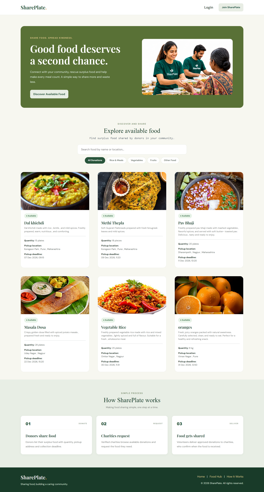

# 🍽️ SharePlate – Food Sharing Platform

<p align="center">
A responsive Django-based food-sharing platform that connects food donors, charities, and volunteers to reduce food waste and help distribute surplus food to people in need.
</p>

---

## 📌 Table of Contents

<p align="center">
<a href="#features">Features</a> •
<a href="#tech-stack">Tech Stack</a> •
<a href="#user-roles">User Roles</a> •
<a href="#project-structure">Project Structure</a> •
<a href="#screenshots">Screenshots</a> •
<a href="#installation">Installation</a> •
<a href="#what-i-learned">What I Learned</a> •
<a href="#author">Author</a>
</p>

---

## <a id="features"></a> Features

### User Authentication
- User Registration
- User Login
- User Logout
- Role-Based Access Control

### Food Donation Management
- Add Food Donations
- Upload Food Images
- Specify Food Quantity and Unit
- Set Pickup Deadlines
- Manage Food Donations
- Track Donation Status

### Charity Management
- Charity Registration
- Charity Verification
- Browse Available Food Donations
- Request Food Pickups
- View Pickup Request Status

### Volunteer Management
- Volunteer Dashboard
- View Available Delivery Tasks
- Accept Delivery Tasks
- Update Delivery Status
- Track Assigned Tasks

### Pickup & Delivery Management
- Manage Pickup Requests
- Approve or Reject Pickup Requests
- Assign Delivery Tasks
- Update Collection and Delivery Status
- Charity Confirmation of Completed Pickups

### Search & Filter
- Browse Available Donations
- Search Food Donations
- Filter Donations by Food Category

---

## <a id="tech-stack"></a> Tech Stack

### Backend
- Python
- Django

### Frontend
- HTML5
- CSS3
- JavaScript
- Bootstrap 5

### Database
- SQLite (Local Development)
- PostgreSQL (Production, if configured)

### Other Technologies
- Pillow (Image Handling)
- Django Authentication System
- Git & GitHub
- VS Code

---

## <a id="user-roles"></a> User Roles

### Donor
- Add and manage food donations
- View incoming pickup requests
- Manage pickup requests

### Charity
- Register and get verified
- Browse available food donations
- Request food pickups
- Confirm completed pickups

### Volunteer
- View available delivery tasks
- Accept delivery assignments
- Update collection and delivery status

---

## <a id="project-structure"></a> Project Structure

```text
SharePlate/
│
├── accounts/
│
├── donations/
│
├── media/
│
├── requests_app/
│
├── shareplate/
│   ├── settings.py
│   ├── urls.py
│   ├── asgi.py
│   ├── wsgi.py
│   └── ...
│
├── venv/
│
├── .gitignore
├── db.sqlite3
├── manage.py
├── requirements.txt
└── README.md
```

---

## <a id="screenshots"></a> Screenshots

<h3>Home Page</h3>

<br>

<p align="center">

</p>

---

## <a id="installation"></a> Installation

### 1. Clone the Repository

```bash
git clone https://github.com/vaidyajanhavi13-bot/SharePlate-django.git
```

### 2. Navigate to the Project Folder

```bash
cd shareplate
```

### 3. Create a Virtual Environment

```bash
python -m venv venv
```

### 4. Activate the Virtual Environment

**Windows**

```bash
venv\Scripts\activate
```

**Linux / macOS**

```bash
source venv/bin/activate
```

### 5. Install Dependencies

```bash
pip install -r requirements.txt
```

### 6. Apply Database Migrations

```bash
python manage.py migrate
```

### 7. Start the Development Server

```bash
python manage.py runserver
```

Open your browser and visit:

```text
http://127.0.0.1:8000/
```

---

## <a id="what-i-learned"></a> What I Learned

While building SharePlate, I gained practical experience with:

- Django Application Development
- User Authentication and Authorization
- Role-Based Access Control
- Django Models and Relationships
- Django Forms
- Image Upload Handling
- Database Management
- Food Donation Management
- Pickup Request Workflows
- Volunteer Delivery Management
- Django Templates
- Responsive Web Design
- Git & GitHub

---

## <a id="author"></a> Author

**Janhavi Vaidya**

<a href="https://github.com/vaidyajanhavi13-bot">GitHub Profile</a>

<a href="https://www.linkedin.com/in/janhavi-vaidya-79b8b4333/">LinkedIn Profile</a>

---
